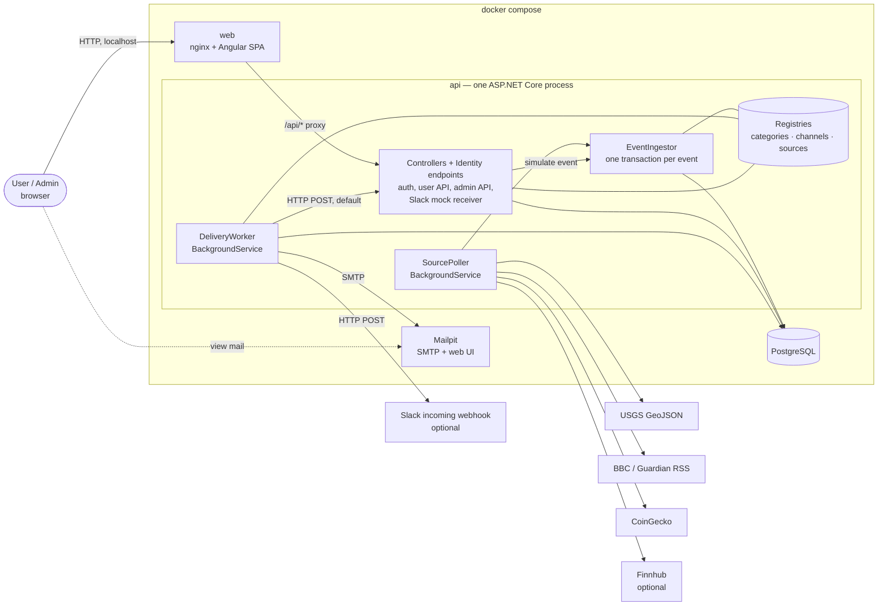

# Architecture

- **Status:** revised after review (phase 3). The raw AI draft is commit `bc48dae`; the diff to this version shows the changes. Review findings and decisions: [`process/log.md`](../process/log.md), phase 3 entries (review, D19–D20).
- **Tool / model:** Claude Code, Claude Opus 5.5 (session 04); review by a fresh subagent with [`prompts/templates/challenge.md`](../prompts/templates/challenge.md).
- **Inputs:** [`spec.md`](spec.md) (incl. §2.12 from D18), [`plan.md`](plan.md) (slices S1–S6), [`../process/log.md`](../process/log.md) (D1–D20), `CLAUDE.md` tech stack.
- **Rule:** this document decides *how* the spec is built. It adds no requirement. Facts that are not verified are not stated here as facts; they are listed in spec §8 and in §7 below.

## 1. Components



- **web:** the Angular build served by nginx. nginx forwards `/api/*` to the API **without stripping the prefix**, so the browser sees one origin and the API needs no CORS setup. Every API route starts with `/api`; a path in the spec such as `/logout` is served as `/api/auth/logout`.
- **api:** one process hosts the controllers, the Identity endpoints and both background services (ADR-1); project layout in §2. The Slack mock receiver (spec §2.6) is an anonymous controller in the same process; the worker reaches it via the Compose service name.
- **db:** PostgreSQL; schema owned by EF Core migrations, applied at API startup (CLAUDE.md). Compose starts the API only after the database healthcheck passes (`depends_on` with `condition: service_healthy`).
- **mailpit:** catches all SMTP mail locally (spec §2.6). Ports as documented in F11; checked in S4.
- **Configuration:** `.env.example` lists every variable (seed admin, SMTP host/port, `FINNHUB_API_KEY`, `SLACK_WEBHOOK_URL`, mock base URL); AC15 copies it to `.env`.
- All times are stored and compared in UTC (`timestamptz`).

## 2. Projects and dependencies (D19)

One project per layer; inside a project, folders by kind. Project references enforce the layer rules: for example, Domain cannot see EF Core and controllers cannot see the DbContext.

```
src/backend/
  Sonrisa.Api              HTTP and hosting (composition root)
    Controllers/             AuthController (logout), AlertsController, DestinationsController,
                             NotificationsController; Admin/ (Users, Events, Deliveries, Audit,
                             SlackMock, Simulate); SlackMockReceiverController
    Filters/                 Identity endpoint filter (audit, 404 for unused endpoints)
    HostedServices/          SourcePoller, DeliveryWorker (thin loops that call Application services)
    Configuration/           DI registration (incl. the source registration, §3.1), auth options,
                             startup migration and seeding
  Sonrisa.Contracts        request and response DTOs (records); no logic, no references
    Dtos/                    Alerts/, Destinations/, Notifications/, Admin/, Events/
  Sonrisa.Application      use cases and ports
    Services/                AlertService, DestinationService, NotificationService, AdminQueryService,
                             AuditService, EventIngestor, DeliveryProcessor
    Abstractions/            repository interfaces, INotificationChannel, IEventSource, IClock
    Registries/              ChannelRegistry, CategoryRegistry, SourceRegistry
    Mapping/                 entity → DTO mapping (hand-written)
    Configuration/           options classes used by services (poll intervals, retry delays, timeouts, assets)
  Sonrisa.Domain           business model, no framework dependencies
    Entities/                Alert, Destination, Event, Delivery, AlertState, AuditEntry
    Categories/              IEventCategory, IObservationStore, NotificationContent;
                             Disaster/, News/, Market/ (rule, data, state records, validator, matcher, describer)
    ValueObjects/            DeliveryStatus, SendResult
  Sonrisa.Infrastructure   everything that talks to the outside
    Persistence/             AppDbContext (Identity), entity configurations, migrations, repositories
    Sources/                 Usgs/, Rss/, CoinGecko/, Finnhub/, MockStocks/, InMemoryObservationStore
    Channels/                Email/ (MailKit), Slack/ (incl. Mock/: SlackMockMessage entity + configuration)
    Configuration/           options classes for SMTP, source URLs, API keys
  Sonrisa.Tests            xUnit: Unit/ (Domain, Application), Integration/ (Api via WebApplicationFactory
                           + PostgreSQL from Testcontainers)
src/frontend/              Angular app (standalone components)
```

| Project | References | Why |
|---|---|---|
| Domain | — | matching (spec §2.2, §2.4) is pure code, so AC6 and AC8 are unit tests without a database |
| Contracts | — | DTOs are the API's public shape; the frontend models mirror them |
| Application | Domain, Contracts | services depend on ports (repositories, channels, sources), not on EF Core or HTTP |
| Infrastructure | Application, Domain | implements the ports |
| Api | Application, Contracts, Infrastructure | controllers call services and return DTOs; Infrastructure is referenced only for DI registration |
| Tests | all | |

- **Controllers** for own endpoints (`[ApiController]`); admin controllers carry `[Authorize(Roles = "Admin")]` under `/api/admin`. `MapIdentityApi` stays minimal API because the framework provides it that way (ADR-4).
- **Repositories** instead of exposing the DbContext to Application. Every user-facing repository method takes the caller's `userId` and filters by it (`GetForUser(id, userId)`, `ListForUser(userId)`); there is no unfiltered user-facing read. Linking a destination to an alert checks that both belong to the caller (AC4). Operations that rely on PostgreSQL behavior (event upsert, delivery insert, due-row query) are named repository methods with integration tests.
- **Extension types** keep their files together by type inside each layer (for example `Infrastructure/Channels/Slack/`, `Domain/Categories/Market/`), so a "how to add" guide lists one folder per layer plus one registration. Entity configurations are picked up by assembly scan (`ApplyConfigurationsFromAssembly`), so a type that needs its own table (the Slack mock) adds files and a migration, not a DbContext change.

## 3. Main flows

### 3.1 Ingestion and matching (spec §2.3–§2.5, ADR-3)

```mermaid
sequenceDiagram
    participant P as SourcePoller
    participant S as Source adapter
    participant I as EventIngestor
    participant C as Category
    participant DB as PostgreSQL
    P->>S: FetchAsync() (per source, own interval)
    S-->>P: normalized events
    loop each event
        P->>I: IngestAsync(event)
        I->>DB: BEGIN
        I->>DB: find by (sourceKey, externalId)
        alt not found: insert, and age ≤ category.MaxAge (if set)
            I->>DB: enabled, not deleted alerts of the category with activeSince < firstSeen
            I->>C: Match(event, alert, state)
            C-->>I: match / no match + new state
            I->>DB: write alert states; insert Delivery per linked, not deleted destination
        else found (revision) or too old
            I->>DB: update row only (T9, T34)
        end
        I->>DB: COMMIT
    end
```

- **One transaction per event:** the event row, the alert states and the delivery rows commit together. A crash before commit leaves nothing, so the next poll sees the item as new again and matches it then. Nothing is lost silently and nothing is half-written.
- **New or existing:** a read inside the transaction decides. Safe because each source is polled by exactly one loop in one process (ADR-1), and simulated events have unique external IDs; the unique index on `(SourceKey, ExternalId)` still rejects a duplicate insert, which then rolls back that event only.
- **Age limit:** `IEventCategory.MaxAge` (2 h for disaster and news, none for market; spec §2.5); no category check in the ingestor.
- Each source runs in its own loop with its own interval and its own try/catch, so one failing source does not stop the others (T26, AC17). The AC17 test registers a throwing fake source through the test host's DI.
- The admin "simulate event" endpoint calls the same `EventIngestor` (T14). Its category-specific fields come from the category (`IEventCategory` simulated-data type and validator; frontend: the category's simulate form in the registry).
- **Source selection:** which stock source runs (Finnhub when `FINNHUB_API_KEY` is set, otherwise mock stocks) is decided once in the source registration in `Api/Configuration`, the one place where sources are registered (T85). No other code checks it.
- **Market observations:** a market source updates `IObservationStore` (latest change per asset, in memory) **after** the event's transaction commits, and emits an event on a 0.5-point grid crossing (spec §2.4, ADR-5).

### 3.2 Delivery (spec §2.6–§2.7)

```mermaid
sequenceDiagram
    participant W as DeliveryWorker
    participant DB as PostgreSQL
    participant Cat as Category
    participant Ch as Channel
    loop every few seconds
        W->>DB: due rows: status Pending and nextAttemptAt ≤ now
        alt alert or destination deleted
            W->>DB: Failed ("alert deleted" / "destination deleted")
        else
            W->>Cat: Describe(event, alert) → NotificationContent
            W->>Ch: Format(content) then SendAsync(destination, formatted) with timeout
            Ch-->>W: Sent | Retryable(error, retryAfter?) | Permanent(error)
            W->>DB: Sent → Sent; Retryable and attempts < 3 → nextAttemptAt; else Failed + lastError
        end
    end
```

- **Who renders what:** the category produces a channel-neutral `NotificationContent` (title, category label, key value, source, link, "SIMULATED" if set, why it matched, alert page link, disclaimer; spec §2.6). The channel only formats it (HTML email, plain-text Slack). No channel knows a category and no category knows a channel (AC9, AC11, AC19).
- **Error policy:** the channel classifies the outcome; the worker owns the attempt count and delays (10 s, 60 s; `Retry-After` capped at 5 min) (D13). Slack: 429, 5xx and timeouts retry, other 4xx are permanent (D13). Email: connection errors, timeouts and SMTP 4xx replies retry; SMTP 5xx replies are permanent.
- **Timeouts:** every send has a timeout from configuration (HTTP and SMTP); a timeout is `Retryable`. A hanging destination therefore delays the batch by at most one timeout and is then rescheduled, so it does not block the other rows (T36).
- The **Notifications page** (spec §2.12) and the admin delivery log are two read-only queries over the same `Deliveries` rows; the user query filters by the alert owner.

### 3.3 Auth (spec §2.8, ADR-4)

- `AddIdentityApiEndpoints<AppUser>()` + `AddRoles<IdentityRole>()` + `MapIdentityApi<AppUser>()` on a route group under `/api/auth`; bearer tokens (not cookies). `AppUser` lives in `Infrastructure/Persistence` (it depends on the Identity package); Domain entities refer to users only by `UserId`.
- `POST /api/auth/logout` in `AuthController` (authorized): `UpdateSecurityStampAsync` → the old refresh token fails at `/refresh` (F8). Access-token lifetime 10 minutes.
- An endpoint filter on the Identity route group answers 404 for the unused endpoints (S1) and writes audit entries for register and login (S2) (spec §2.8, unverified, fallback: own endpoints).
- **Frontend tokens (D20):** the access token is kept in memory only; the refresh token in `sessionStorage`, so a page reload keeps the user logged in and closing the tab ends the session. An HTTP interceptor adds the bearer header and calls `/refresh` once on 401; logout calls `/logout` and clears both. Route guards: logged-in, admin. Known limit: script injection (XSS) could read the refresh token (spec §7).
- Admin endpoints: controllers under `Controllers/Admin/`, route prefix `/api/admin`, `[Authorize(Roles = "Admin")]` on each. AC3 enumerates every endpoint with the `/api/admin` prefix from the endpoint data source (unverified that controller actions appear there with their metadata, §7).

## 4. Data model

Identity tables (`AspNetUsers`, `AspNetRoles`, …) come from `IdentityDbContext`. Own tables:

| Table | Key columns | Notes |
|---|---|---|
| `Destinations` | `Id`, `UserId`, `ChannelKey`, `DisplayName`, `Config` (jsonb), `DeletedAt` | soft delete (spec §2.6) |
| `Alerts` | `Id`, `UserId`, `Name`, `CategoryKey`, `Rule` (jsonb), `Enabled`, `ActiveSince`, `CreatedAt`, `DeletedAt` | soft delete (D20); index `(CategoryKey, Enabled)` for matching |
| `AlertDestinations` | `(AlertId, DestinationId)` | many-to-many (T67) |
| `AlertStates` | `AlertId` (PK), `State` (jsonb) | per-alert matcher state, shape owned by the category; only stateful categories (market: armed and last level per direction, spec §2.4) write rows |
| `Events` | `Id`, `CategoryKey`, `SourceKey`, `ExternalId`, `Title`, `Summary`, `Url`, `PublishedAt`, `FirstSeenAt`, `UpdatedAt`, `IsSimulated`, `Data` (jsonb) | **unique `(SourceKey, ExternalId)`** (T31) |
| `Deliveries` | `Id`, `AlertId`, `EventId`, `DestinationId`, `Status`, `Attempts`, `NextAttemptAt`, `LastError`, `CreatedAt`, `SentAt` | **unique `(AlertId, EventId, DestinationId)`** (D16, AC13); index `(Status, NextAttemptAt)` |
| `AuditEntries` | `Id`, `At`, `ActorUserId`, `Action`, `TargetType`, `TargetId`, `Outcome` | append-only (spec §2.10) |
| `SlackMockMessages` | `Id`, `HookName`, `Body`, `ReceivedAt` | owned by the Slack channel's mock (`Infrastructure/Channels/Slack/Mock`) |

- `Rule`, `Config`, `State` and `Data` are jsonb columns whose shape belongs to the category or channel (ADR-2). Core code stores and passes them without reading them.
- **Deletes:** alerts and destinations are soft-deleted; foreign keys from `Deliveries` are `RESTRICT`, so history is never cascaded away. Deleting either turns its `Pending` deliveries into `Failed`; the worker also checks `DeletedAt` before each send (a send already in flight completes).
- **Masking:** responses and audit entries never carry a raw `Config`; they carry `INotificationChannel.MaskConfig(config)` (Slack: last 4 characters of the URL) (AC18).

## 5. What each slice builds

| Slice | Backend | Frontend | Tables |
|---|---|---|---|
| S1 | Compose (with healthcheck), `.env.example`, the six projects of §2, DbContext + first migration, Identity, `AuthController` (logout), endpoint filter (404 part), Testcontainers test base, CI | shell, landing, register, login, logout, auth service + interceptor | Identity |
| S2 | `Admin` role + seeding, admin controllers, audit service, endpoint filter (audit part) | admin area: users, audit log; admin guard | `AuditEntries` |
| S3a | category interface + registry with disaster and news (data shape, `MaxAge`, simulated data), source interface + registry, `SourcePoller`, `EventIngestor` (insert/update only, no alerts yet), USGS, RSS, simulate controller | admin events list, category registry with simulate forms | `Events` |
| S3b | matching in `EventIngestor`, category rules and `Describe` (disaster, news), channel interface + registry with `ValidateConfig` / `MaskConfig` (email, Slack), destinations and alerts API, back-fill query, notifications query | destinations, alerts with rule forms, Notifications page | `Destinations`, `Alerts`, `AlertDestinations`, `Deliveries` |
| S4 | `DeliveryWorker`, `Format` + `SendAsync` for email (MailKit) and Slack, Slack mock receiver | admin delivery log, Slack mock list; statuses on the Notifications page | `SlackMockMessages` |
| S5 | market category (rule, state, start state), `IObservationStore`, CoinGecko, mock stocks, Finnhub | market rule form, market simulate form | `AlertStates` |
| S6 | — | — | — (guides, the AC11 `grep` in the README, clean-clone run) |

## 6. Architecture decision records

### ADR-1 One deployable: API and background services in one process

- **Context:** the app needs HTTP endpoints, periodic polling of 5+ sources and a delivery worker (spec §2.5, §2.7). It runs locally with `docker compose up` (T25).
- **Decision:** one ASP.NET Core process hosts the controllers, `SourcePoller` and `DeliveryWorker` as `BackgroundService`s. Exactly one API instance is assumed.
- **Alternatives:** (a) a separate worker service: cleaner scaling, but a second container, shared code via a library and two configurations for no demo benefit; (b) a message broker (T28, rejected): another container and failure mode the brief does not need.
- **Consequences:** simple to run and test (one `WebApplicationFactory` covers all). In-memory state (market observations, ADR-5) is shared between the poller and the alert service without a store. The "new or existing" read in §3.1 and the lock-free worker rely on one instance; running two would double polling and could double-send. Scale-out is out of scope (T72, spec §7).

### ADR-2 Extension points: interface + registry, typed JSON per type, content model between category and channel

- **Context:** channels, categories and sources must be addable without touching shared code (D10, T85); no `switch` on type keys outside registries (T59, AC11). A message combines category data (key value, disclaimer) with channel format (HTML, Slack text).
- **Decision:** three interfaces, each with a string `Key`:
  - `IEventCategory` (Domain, pure): rule, data, state and simulated-data types with validators; `MaxAge`; `Match(event, alert, state)` → match + new state; `InitialState(rule, IObservationStore)`; `Describe(event, alert)` → `NotificationContent`; back-fill support flag;
  - `INotificationChannel` (`Application/Abstractions`): `ValidateConfig`, `MaskConfig`, `Format(NotificationContent)`, `SendAsync` → `Sent | Retryable | Permanent`;
  - `IEventSource` (`Application/Abstractions`): `Category`, `Interval`, `FetchAsync`.
  Implementations are registered once in DI; a registry turns `IEnumerable<T>` into a dictionary by key and rejects duplicate keys at startup. Per-type rule, config, state and event data are stored as jsonb and (de)serialized only by the owning implementation. The frontend registry maps a key to standalone components: category → rule form, simulate form, event detail; channel → config form.
- **Alternatives:** (a) one table or column set per type (T59 rejected: every new channel needs a migration and core changes); (b) EF Core inheritance (TPH) per type: typed queries, but adding a type changes the DbContext and needs a migration; (c) the channel renders the event itself: every channel would branch on category; (d) runtime plugins (T61 rejected).
- **Consequences:** a new type is new files + one registration per side (guides in S6). Jsonb content is not validated by the database; each implementation validates on write. Queries cannot filter by rule fields (not needed: matching loads the alerts of one category, T71).

### ADR-3 Transactional ingestion and a delivery queue in the database

- **Context:** one event can create several notifications; a send can fail; a match must not be lost or duplicated (T33, T36, AC13); max 3 attempts with a per-channel error policy (D13).
- **Decision:** the event row, alert states and `Deliveries` rows (`Pending`) are written in **one transaction per event** (§3.1); the unique index `(AlertId, EventId, DestinationId)` is the last guard against duplicates. `DeliveryWorker` polls due rows, sends with a timeout, and writes status, attempts, `NextAttemptAt` and `LastError`.
- **Alternatives:** (a) send inline during ingestion: a slow webhook would block ingestion, and there is no retry record; (b) in-memory `Channel<T>` queue: lost on restart, no history for the Notifications page; (c) broker (T28 rejected); (d) separate writes without a transaction (raw draft): a crash between them loses a match silently or re-fires a market alert.
- **Consequences:** matches survive restarts; the admin log and the Notifications page read the same rows (spec §2.12). Latency is up to one worker interval. Sends are at-least-once: a crash between a successful send and the status update resends that one message (spec §7, accepted in D20). A single worker instance means no row locking (ADR-1).

### ADR-4 Auth with Identity API endpoints and security-stamp logout

- **Context:** real register, login and logout (D2, D5); roles for the admin view (T51); `MapIdentityApi` has no logout and its tokens are stateless (F8).
- **Decision:** `AddIdentityApiEndpoints` + `AddRoles<IdentityRole>()` + `MapIdentityApi`, bearer tokens; `/api/auth/logout` updates the security stamp so the refresh token is rejected; access-token lifetime 10 minutes (D9); one `Admin` role, seeded admin from env (T51). Audit and the 404 for unused endpoints via an endpoint filter on the Identity route group. In the browser: access token in memory, refresh token in `sessionStorage` (D20).
- **Alternatives:** (a) own JWT issuing: full control (token revocation lists), but security code we would have to write and test; (b) cookie auth: simpler logout and no token in script reach, but CSRF handling, and the spec chose bearer tokens; (c) per-request security-stamp validation (rejected in D9); (d) both tokens in `localStorage`: survives a browser restart, but both are readable by injected script; (e) memory only: safest, but every reload logs out, which gets in the way of the manual checks.
- **Consequences:** an access token stays valid up to 10 minutes after logout; the refresh token is readable by injected script for the life of the tab (spec §7). The role claim in the bearer token, the endpoint filter, and `MapIdentityApi` on a prefixed group are unverified and checked first in S1/S2 (spec §8). If the filter cannot see the result, own `/register` and `/login` endpoints replace the mapped ones.

### ADR-5 Market state: last observation in memory, alert state in the database

- **Context:** market events are computed from two consecutive observations (spec §2.4); alerts re-arm with hysteresis and escalate in steps (D14); no own price history (T22).
- **Decision:** market sources keep the last observed change per asset in `IObservationStore`, an in-memory singleton; no event on the first poll after start. Each alert's armed state and last level per direction live in `AlertStates` (jsonb, shape owned by the market category) and are written in the event's transaction (ADR-3). When an alert becomes active (create, re-enable, rule change; spec §2.4–§2.5), `AlertService` asks the category for `InitialState(rule, IObservationStore)`; the service has no market-specific code.
- **Alternatives:** (a) store the latest observation in a table: survives restarts, but it is the start of a price history (T22) and adds a table only for the first poll; (b) keep alert state in memory too: lost on restart, so a restart would re-fire every alert past its threshold; (c) a typed `MarketAlertStates` table (raw draft): a core table for one category, against ADR-2.
- **Consequences:** after a restart the first poll of each market source emits nothing, so a crossing during the restart is missed (spec §7, accepted in D20). If no observation exists yet when an alert becomes active, it starts armed. For disaster and news the state is empty and no `AlertStates` row is written.

## 7. Open points for the slices

- **New packages** (rule 4, approval with a version check on NuGet / npm in the slice that first needs them): `Npgsql.EntityFrameworkCore.PostgreSQL`, `Microsoft.AspNetCore.Identity.EntityFrameworkCore`, `Microsoft.EntityFrameworkCore.Design` (S1, Infrastructure only; Application and Domain stay free of EF Core); `xunit`, `Microsoft.AspNetCore.Mvc.Testing`, `Testcontainers.PostgreSql` (S1, D20); MailKit (approved, D13, S4); Angular (S1).
- **Unverified framework behavior, checked in the named slice** (also in spec §8): controller actions appear in the endpoint data source with their `[Authorize]` metadata (S2, AC3); `MapIdentityApi` works on a `/api/auth` group (S1); insert of delivery rows that relies on the unique index inside the event transaction, with EF Core or raw SQL (S3b); jsonb mapping of `Rule`, `Config`, `State` and `Data` with the Npgsql provider (S3a/S3b); Testcontainers on the GitHub Actions runner (S1).
- Unverified source and service facts: spec §8.
