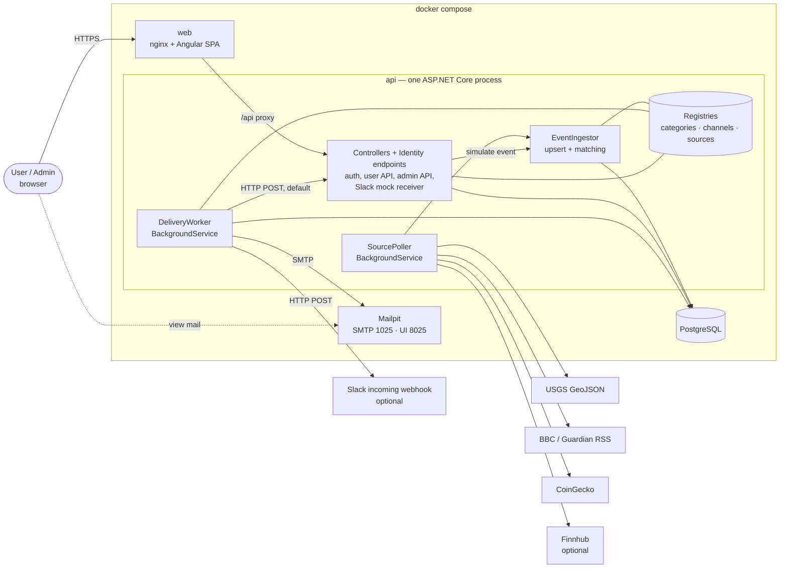
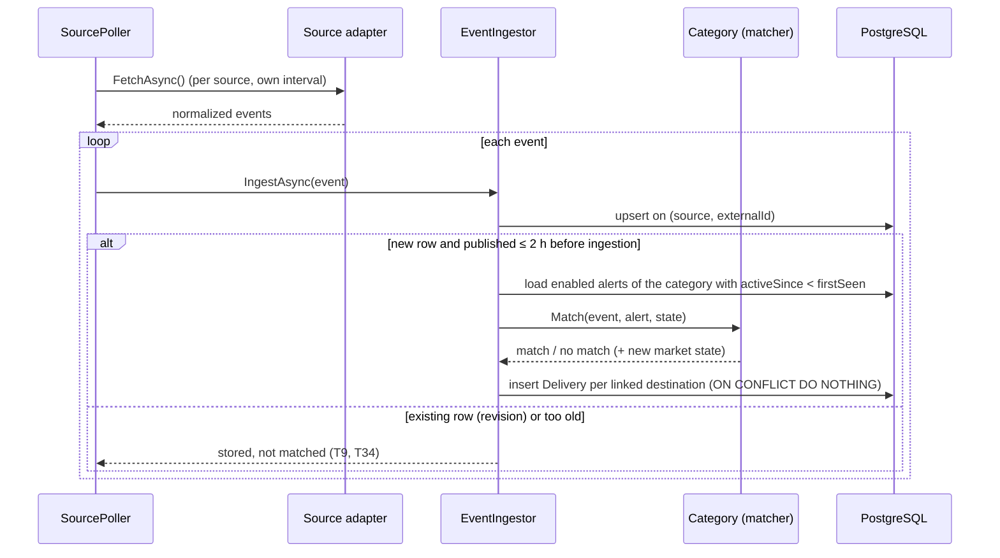

# Architecture

- **Status:** raw AI draft (phase 3), not yet reviewed.
- **Tool / model:** Claude Code, Claude Opus 5.5 (session 04).
- **Inputs:** [`spec.md`](spec.md) (incl. §2.12 from D18), [`plan.md`](plan.md) (slices S1–S6), [`../process/log.md`](../process/log.md) (D1–D18), `CLAUDE.md` tech stack.
- **Rule:** this document decides *how* the spec is built. It adds no requirement. Facts that are not verified are not stated here; they are listed in spec §8 and in §7 below.

## 1. Components



- **web:** the Angular build served by nginx; nginx proxies `/api/*` to the API, so the browser sees one origin and the API needs no CORS setup.
- **api:** one process hosts the controllers, the Identity endpoints and both background services (ADR-1); project layout in §2. The Slack mock receiver (spec §2.6) is a set of anonymous endpoints in the same process; the worker reaches it via the Compose service name.
- **db:** PostgreSQL; schema owned by EF Core migrations, applied at API startup (CLAUDE.md).
- **mailpit:** catches all SMTP mail locally (spec §2.6, F11).
- All times are stored and compared in UTC.

## 2. Projects and dependencies (D19)

One project per layer; inside a project, folders by kind. Project references enforce the layer rules: for example, Domain cannot see EF Core and controllers cannot see the DbContext.

```
src/backend/
  Sonrisa.Api              HTTP and hosting (composition root)
    Controllers/             AuthController (/logout), AlertsController, DestinationsController,
                             NotificationsController; Admin/ (Users, Events, Deliveries, Audit,
                             SlackMock, Simulate); SlackMockReceiverController
    Filters/                 Identity endpoint filter (audit, 404 for unused endpoints)
    HostedServices/          SourcePoller, DeliveryWorker (thin loops that call Application services)
    Configuration/           DI registration, auth options, startup migration and seeding
  Sonrisa.Contracts        request and response DTOs (records); no logic, no references
    Dtos/                    Alerts/, Destinations/, Notifications/, Admin/, Events/
  Sonrisa.Application      use cases and ports
    Services/                AlertService, DestinationService, NotificationService, AdminQueryService,
                             AuditService, EventIngestor, DeliveryProcessor
    Abstractions/            repository interfaces, INotificationChannel, IEventSource, IClock
    Registries/              ChannelRegistry, CategoryRegistry, SourceRegistry
    Mapping/                 entity → DTO mapping (hand-written)
    Configuration/           options classes used by services (poll intervals, retry delays, assets)
  Sonrisa.Domain           business model, no framework dependencies
    Entities/                Alert, Destination, Event, Delivery, MarketAlertState, AuditEntry, SlackMockMessage
    Categories/              IEventCategory; Disaster/, News/, Market/ (rule record, validator, matcher)
    ValueObjects/            DeliveryStatus, MarketDirection, SendResult
  Sonrisa.Infrastructure   everything that talks to the outside
    Persistence/             AppDbContext (Identity), entity configurations, migrations, repositories
    Sources/                 Usgs/, Rss/, CoinGecko/, Finnhub/, MockStocks/
    Channels/                Email/ (MailKit), Slack/
    Configuration/           options classes for SMTP, source URLs, API keys
  Sonrisa.Tests            xUnit: Unit/ (Domain, Application), Integration/ (Api via WebApplicationFactory)
src/frontend/              Angular app (standalone components)
```

| Project | References | Why |
|---|---|---|
| Domain | — | matching (spec §2.2, §2.4) is pure code, so AC6 and AC8 are unit tests without a database |
| Contracts | — | DTOs are the API's public shape; the frontend models mirror them |
| Application | Domain, Contracts | services depend on ports (repositories, channels, sources), not on EF Core or HTTP |
| Infrastructure | Application, Domain | implements the ports |
| Api | Application, Contracts, Infrastructure | controllers call services and return DTOs; Infrastructure is referenced only for DI registration |
| Tests | all | |

- **Controllers** for own endpoints (`[ApiController]`); admin controllers carry `[Authorize(Roles = "Admin")]` under `/api/admin`. `MapIdentityApi` stays minimal API because the framework provides it that way (ADR-4).
- **Repositories** instead of exposing the DbContext to Application: the operations that rely on PostgreSQL behavior (upsert on `(SourceKey, ExternalId)`, `ON CONFLICT DO NOTHING` on deliveries, due-row query) are named repository methods with integration tests.
- **Extension types** keep their files together by type inside each layer (for example `Infrastructure/Channels/Slack/`, `Domain/Categories/Market/`), so a "how to add" guide lists one folder per layer plus one registration.

## 3. Main flows

### 3.1 Ingestion and matching (spec §2.3–§2.5)



- Each source runs in its own loop with its own interval and its own try/catch, so one failing source does not stop the others (T26, AC17).
- The admin "simulate event" endpoint calls the same `EventIngestor` (T14).
- Market events: the market source keeps the last observed change per asset in memory and emits an event on a 0.5-point grid crossing (spec §2.4, ADR-5).

### 3.2 Delivery (spec §2.7)

```mermaid
sequenceDiagram
    participant W as DeliveryWorker
    participant DB as PostgreSQL
    participant R as Channel registry
    participant Ch as Channel (email / Slack)
    loop every few seconds
        W->>DB: due rows: status Pending and nextAttemptAt ≤ now
        W->>R: channel for destination.channelKey
        R-->>W: channel
        W->>Ch: Render(event, alert) then SendAsync(destination, message)
        Ch-->>W: Sent | Retryable(error, retryAfter?) | Permanent(error)
        W->>DB: Sent → status Sent; Retryable and attempts < 3 → nextAttemptAt; else Failed + lastError
    end
```

- The channel classifies the outcome; the worker owns the attempt count and delays (10 s, 60 s; `Retry-After` capped at 5 min) (D13). No channel-specific code in the worker (T59).
- The **Notifications page** (spec §2.12) and the admin delivery log are two read-only queries over the same `Deliveries` rows; the user query filters by the alert owner.

### 3.3 Auth (spec §2.8)

- `AddIdentityApiEndpoints<AppUser>()` + `AddRoles<IdentityRole>()` + `MapIdentityApi<AppUser>()` under `/api/auth`; bearer tokens (not cookies). `AppUser` lives in `Infrastructure/Persistence` (it depends on the Identity package); Domain entities refer to users only by `UserId`.
- Own `POST /api/auth/logout` in `AuthController` (authorized): `UpdateSecurityStampAsync` → the old refresh token fails at `/refresh` (F8). Access-token lifetime 10 minutes.
- An endpoint filter on the Identity route group writes audit entries for register and login and answers 404 for the unused endpoints (spec §2.8, unverified, fallback: own endpoints).
- Frontend: tokens kept by an auth service; an HTTP interceptor adds the bearer header and calls `/refresh` once on 401; logout calls `/logout` and discards both tokens. Route guards: logged-in, admin.
- Admin endpoints: controllers under `Controllers/Admin/`, route prefix `/api/admin`, `[Authorize(Roles = "Admin")]` on each. AC3 enumerates every endpoint with the `/api/admin` prefix from the endpoint data source (controller actions are endpoints too).

## 4. Data model

Identity tables (`AspNetUsers`, `AspNetRoles`, …) come from `IdentityDbContext`. Own tables:

| Table | Key columns | Notes |
|---|---|---|
| `Destinations` | `Id`, `UserId`, `ChannelKey`, `DisplayName`, `Config` (jsonb), `DeletedAt` | soft delete (spec §2.6); Slack URL masked in every response |
| `Alerts` | `Id`, `UserId`, `Name`, `CategoryKey`, `Rule` (jsonb), `Enabled`, `ActiveSince`, `CreatedAt` | index `(CategoryKey, Enabled)` for matching |
| `AlertDestinations` | `(AlertId, DestinationId)` | many-to-many (T67) |
| `MarketAlertStates` | `(AlertId, Direction)`, `Armed`, `LastNotifiedLevel` | spec §2.4; only market alerts have rows |
| `Events` | `Id`, `CategoryKey`, `SourceKey`, `ExternalId`, `Title`, `Summary`, `Url`, `PublishedAt`, `FirstSeenAt`, `UpdatedAt`, `IsSimulated`, `Data` (jsonb) | **unique `(SourceKey, ExternalId)`** (T31) |
| `Deliveries` | `Id`, `AlertId`, `EventId`, `DestinationId`, `Status`, `Attempts`, `NextAttemptAt`, `LastError`, `CreatedAt`, `SentAt` | **unique `(AlertId, EventId, DestinationId)`** (D16, AC13); index `(Status, NextAttemptAt)` |
| `AuditEntries` | `Id`, `At`, `ActorUserId`, `Action`, `TargetType`, `TargetId`, `Outcome` | append-only (spec §2.10) |
| `SlackMockMessages` | `Id`, `HookName`, `Body`, `ReceivedAt` | written by the mock receiver |

`Rule`, `Config` and `Data` are jsonb columns whose shape belongs to the category or channel (ADR-2). Core code stores and passes them without reading them.

## 5. What each slice builds

| Slice | Backend | Frontend | Tables |
|---|---|---|---|
| S1 | Compose, the six projects of §2, DbContext + first migration, Identity, `AuthController` (`/logout`), endpoint filter | shell, landing, register, login, logout, auth service + interceptor | Identity |
| S2 | `Admin` role + seeding, admin route group, audit service | admin area: users, audit log; admin guard | `AuditEntries` |
| S3a | source interface + registry, `SourcePoller`, `EventIngestor` (no matching yet), USGS, RSS, simulate endpoint | admin events list, simulate form | `Events` |
| S3b | category + channel interfaces and registries (disaster, news; email, Slack config only), destinations and alerts API, matching, back-fill query, notifications query | destinations, alerts with category rule forms, Notifications page | `Destinations`, `Alerts`, `AlertDestinations`, `Deliveries` |
| S4 | `DeliveryWorker`, email channel (MailKit), Slack channel, Slack mock | admin delivery log, Slack mock list; statuses on the Notifications page | `SlackMockMessages` |
| S5 | market category, CoinGecko, mock stocks, Finnhub | market rule form | `MarketAlertStates` |
| S6 | — | — | — (guides, checks) |

## 6. Architecture decision records

### ADR-1 One deployable: API and background services in one process

- **Context:** the app needs HTTP endpoints, periodic polling of 5+ sources and a delivery worker (spec §2.5, §2.7). It runs locally with `docker compose up` (T25).
- **Decision:** one ASP.NET Core process hosts the endpoints, `SourcePoller` and `DeliveryWorker` as `BackgroundService`s. Exactly one API instance is assumed.
- **Alternatives:** (a) a separate worker service: cleaner scaling, but a second container, shared code via a library and two configurations for no demo benefit; (b) a message broker (T28, rejected): another container and failure mode the brief does not need.
- **Consequences:** simple to run and test (one `WebApplicationFactory` covers all). In-memory state (market observations, ADR-5) is shared between the poller and the alert endpoints without a store. Running two instances would double polling and could double-send; scale-out is out of scope (T72) and listed as a known limit.

### ADR-2 Extension points: interface + registry, typed JSON per type

- **Context:** channels, categories and sources must be addable without touching shared code (D10, T85); no `switch` on type keys outside registries (T59, AC11).
- **Decision:** three interfaces, each with a string `Key` (`IEventCategory` in Domain because matching is pure; `INotificationChannel` and `IEventSource` in `Application/Abstractions` because they do I/O):
  - `INotificationChannel`: `ValidateConfig`, `Render`, `SendAsync` → `Sent | Retryable | Permanent`;
  - `IEventCategory`: `ValidateRule`, `Match(event, alert, state)`, rule and data record types, back-fill support flag;
  - `IEventSource`: `Category`, `Interval`, `FetchAsync`.
  Implementations are registered once in DI; a registry turns `IEnumerable<T>` into a dictionary by key and rejects duplicate keys at startup. Per-type rule, config and event data are stored as jsonb and (de)serialized only by the owning implementation. The frontend has a matching registry: key → standalone component for the rule form, config form and event detail.
- **Alternatives:** (a) one table or column set per type (T59 rejected: every new channel needs a migration and core changes); (b) EF Core inheritance (TPH) per type: typed queries, but adding a type changes the DbContext and needs a migration; (c) runtime plugins (T61 rejected).
- **Consequences:** a new type is new files + one registration per side (guides in S6). Jsonb content is not validated by the database; each implementation validates on write. Queries cannot filter by rule fields (not needed: matching loads the alerts of one category, T71).

### ADR-3 Delivery queue in the database

- **Context:** one event can create several notifications; a send can fail; duplicates must not happen (T33, T36, AC13); max 3 attempts with a Slack-specific error policy (D13).
- **Decision:** matching inserts `Deliveries` rows (`Pending`) in the same transaction-free step as the match, protected by the unique index `(AlertId, EventId, DestinationId)` and `ON CONFLICT DO NOTHING`. `DeliveryWorker` polls due rows, sends one at a time, and writes status, attempts, `NextAttemptAt` and `LastError`.
- **Alternatives:** (a) send inline during ingestion: a slow or failing webhook would block ingestion, and there is no retry record; (b) in-memory `Channel<T>` queue: lost on restart, no audit trail; (c) broker (T28 rejected).
- **Consequences:** deliveries survive restarts; the admin log and the Notifications page read the same rows (spec §2.12). Latency is up to one worker interval. Sends are at-least-once: a crash between a successful send and the status update resends that one message on restart (known limit). A single worker instance means no row locking is needed (ADR-1).

### ADR-4 Auth with Identity API endpoints and security-stamp logout

- **Context:** real register, login and logout (D2, D5); roles for the admin view (T51); `MapIdentityApi` has no logout and its tokens are stateless (F8).
- **Decision:** `AddIdentityApiEndpoints` + `AddRoles<IdentityRole>()` + `MapIdentityApi`, bearer tokens; own `/logout` updates the security stamp so the refresh token is rejected; access-token lifetime 10 minutes (D9); one `Admin` role, seeded admin from env (T51). Audit and the 404 for unused endpoints via an endpoint filter on the Identity route group.
- **Alternatives:** (a) own JWT issuing: full control (token revocation lists), but security code we would have to write and test; (b) cookie auth: simpler logout, but CSRF handling and the spec chose bearer tokens; (c) per-request security-stamp validation (rejected in D9).
- **Consequences:** an access token stays valid up to 10 minutes after logout (spec §7). Two facts are unverified and checked first in S1/S2: the role claim in the bearer token and the endpoint filter (spec §8). If the filter cannot see the result, own `/register` and `/login` endpoints replace the mapped ones.

### ADR-5 Market state: last observation in memory, alert state in the database

- **Context:** market events are computed from two consecutive observations (spec §2.4); alerts re-arm with hysteresis and escalate in steps (D14); no own price history (T22).
- **Decision:** each market source keeps the last observed change per asset in a singleton in memory; no event on the first poll after start. Per-alert `Armed` / `LastNotifiedLevel` per direction live in `MarketAlertStates` and are updated in the same step as the match. A new or re-enabled alert reads the latest in-memory observation to choose its start state.
- **Alternatives:** (a) store observations in a table: survives restarts, but it is the start of a price history (T22) and adds a table only for the first poll; (b) keep alert state in memory too: lost on restart, so a restart would re-fire every alert past its threshold.
- **Consequences:** after a restart the first poll of each market source emits nothing, so a crossing during the restart is missed (known limit). If no observation exists yet when an alert is created, it starts armed. Market matching is stateful, so `IEventCategory.Match` receives and returns state; for disaster and news the state is empty.

## 7. Open points for the slices

- **New packages** (rule 4, approval in the slice that first needs them): `Npgsql.EntityFrameworkCore.PostgreSQL`, `Microsoft.AspNetCore.Identity.EntityFrameworkCore`, `Microsoft.EntityFrameworkCore.Design` (S1, Infrastructure only; Application and Domain stay free of EF Core); `xunit` + `Microsoft.AspNetCore.Mvc.Testing` (S1); MailKit (approved, D13, S4); Angular (S1). Versions are checked on NuGet / npm at approval time.
- **Integration tests need PostgreSQL** (unique index, upsert, jsonb). How the tests and CI get a database is decided in S1.
- **Jsonb mapping** of `Rule`, `Config` and `Data` with the Npgsql EF Core provider is checked in S3b.
- Unverified framework and source facts: spec §8.
